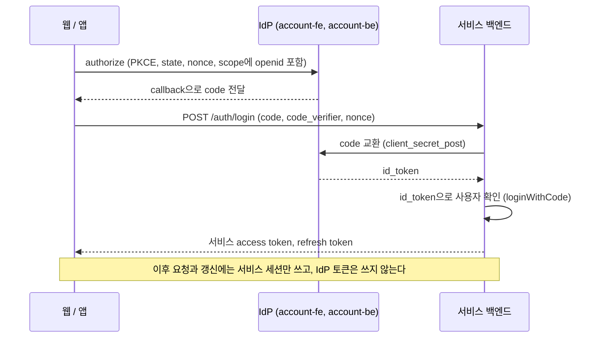

# account-sdk

인포팀 계정(IdP, account.gistory.me)에 서비스를 붙이는 SDK.

서비스는 IdP 환경 이름과 client id만 넘기고, 로그인 흐름과 토큰 갱신, 서비스 세션 관리는 SDK에 맡긴다.

## 패키지

| 패키지                                               | 용도                                                          | 배포            |
| ---------------------------------------------------- | ------------------------------------------------------------- | --------------- |
| [`@gsainfoteam/account-react`](packages/react)       | React 앱. web을 포함한다                                      | GitHub Packages |
| [`@gsainfoteam/account-web`](packages/web)           | React를 쓰지 않는 웹 앱                                       | GitHub Packages |
| [`@gsainfoteam/account-nest`](packages/nest)         | NestJS 백엔드. server를 포함한다                              | GitHub Packages |
| [`@gsainfoteam/account-server`](packages/server)     | NestJS를 쓰지 않는 Node, Bun 백엔드                           | GitHub Packages |
| [`@gsainfoteam/account-core`](packages/core)         | 위 패키지들의 공용 코어. 직접 설치할 일은 드물다              | GitHub Packages |
| [`@gsainfoteam/account-contract`](packages/contract) | IdP와 SDK가 함께 쓰는 값(scope, 거절 사유). account-be도 쓴다 | GitHub Packages |
| [`gsainfoteam_account`](packages/flutter)            | Flutter 앱                                                    | pub.dev         |

npm 패키지는 GitHub Packages에서 받으므로 설치하려면 인증이 필요하다. 설정 방법은 각 패키지 README에 있다.

## 로그인 흐름



NestJS라면 `@gsainfoteam/account-nest`의 세션 모듈이 서비스 백엔드 쪽을 모두 맡는다.

프론트가 IdP access token을 백엔드에 넘기는 방식은 지원하지 않는다. account-be의 access token에는 대상 client가 없어서,
누구나 등록할 수 있는 다른 client의 토큰으로도 로그인할 수 있기 때문이다. 백엔드가 직접 교환해 받은 id_token으로는 그럴 수 없다.

IdP 토큰은 로그인할 때 한 번만 쓰므로 `offline_access`는 요청하지 않는다. 이 scope를 요청하면 account-fe가 로그인할 때마다
동의 화면을 띄운다.

### IdP client 등록

서비스마다 account-fe의 client 설정 화면에서 한 번 한다.

1. client를 등록한다. redirect URI로 웹 callback(`https://<서비스>/auth/callback`)과 앱 scheme을 넣는다.
2. 필수 scope와 선택 scope를 고른다. 백엔드의 `requiredScopes`에는 필수 scope만 넣는다.
3. 인증 방식을 `client_secret_post`로 정한다. 새로 등록하는 client는 이것이 기본값이다.
4. secret을 받아 서비스 백엔드의 환경 변수에 넣는다.

## IdP 연동 방식

- IdP 주소와 경로는 discovery(`/.well-known/openid-configuration`)에서 가져온다. account-be의 discovery 문서에 있는 결함은
  `normalizeDiscovery` 한 곳에서만 보정한다.
- 여러 언어가 함께 쓰는 값(IdP 주소, 경로, 저장소 키 namespace)은
  [`packages/core/src/constants/idp.json`](packages/core/src/constants/idp.json)에 둔다. Flutter 패키지는 테스트로
  이 파일과 값이 같은지 확인한다.
- scope와 거절 사유, scope별 사용자 필드(`SCOPE_CLAIMS`)는 [`@gsainfoteam/account-contract`](packages/contract)에 둔다.
  account-be와 SDK가 모두 이 패키지를 import 하고, Dart enum은 `pnpm contract:dart`가 여기서 생성한다.

## 개발

[mise](https://mise.jdx.dev)로 Node, pnpm, Flutter 버전을 맞춘다.

```bash
mise install
pnpm install
```

```bash
pnpm build          # 모든 npm 패키지 빌드 (turbo)
pnpm typecheck
pnpm lint
pnpm test           # 단위 테스트. IdP 에 요청하지 않는다
pnpm format         # prettier 검사
pnpm examples:build # examples 빌드

mise run check      # 위 검사를 CI 와 같은 순서로 실행
mise run test:live  # 운영과 스테이징 IdP 에 실제로 요청하는 테스트
pnpm contract:dart  # packages/contract 에서 Dart enum 다시 생성
```

Flutter 패키지는 `packages/flutter`에서 `flutter analyze`와 `flutter test`로 검사한다.

### 스테이징 로그인 확인

[`examples/web`](examples/web)(Vite, React, TanStack Router)과 [`examples/nest`](examples/nest)(CommonJS로 빌드한 Nest
백엔드)를 함께 띄우면 로그인 흐름 전체를 확인할 수 있다.

1. 스테이징 IdP에 client를 등록하고, redirect URI로 `http://localhost:5173/auth/callback`을 넣는다. `examples/nest`가
   `requiredScopes: ['name']`으로 선언되어 있으므로 `name`은 필수 scope로 등록한다.
2. `.env.example`을 `.env`로 복사하고 client id와 secret을 채운다. mise가 `.env`를 읽어 각 task에 넣어 준다.
3. `mise run example:api`와 `mise run example:web`을 각각 띄우고 http://localhost:5173 을 연다.

### 배포

[changesets](https://github.com/changesets/changesets)로 버전을 올린다. 모든 패키지가 같은 버전을 쓴다.

```bash
pnpm changeset           # 변경 기록
pnpm version:packages    # 버전 반영. Flutter pubspec 도 같은 버전으로 맞춘다
```

`v*` 태그를 push 하면 GitHub Actions가 npm 패키지를 GitHub Packages에, Flutter 패키지를 pub.dev에 배포한다.
