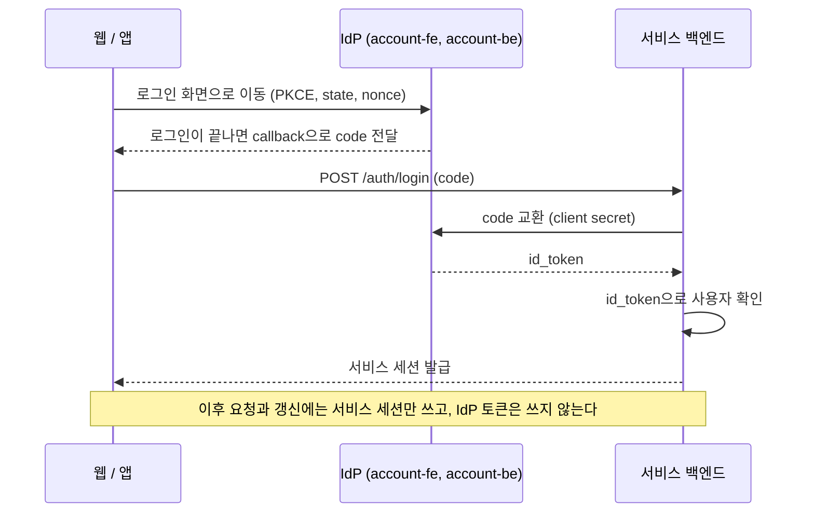

# account-sdk

인포팀 계정(IdP, [account.gistory.me](https://account.gistory.me))으로 로그인하는 기능을 서비스에 붙이는 SDK입니다.

| 구분          | 역할                                                                            |
| ------------- | ------------------------------------------------------------------------------- |
| 프론트 SDK    | IdP 로그인, 세션 유지(토큰 갱신, 로그아웃)                                      |
| 백엔드 SDK    | IdP와 code를 교환하고 id_token으로 사용자 확인                                  |
| 서비스 백엔드 | 서비스 세션 발급, 갱신, 로그아웃. [세션 프로토콜](#세션-프로토콜)대로 직접 구현 |

## 시작 순서

1. IdP에 서비스를 client로 등록합니다. [IdP client 등록](#idp-client-등록)을 참고합니다.
2. 백엔드에 [`@infoteam/account-nest`](packages/nest)나 [`@infoteam/account-server`](packages/server)를 붙이고, [세션 프로토콜](#세션-프로토콜)의 로그인, 갱신, 로그아웃 endpoint를 만듭니다.
3. 프론트에 [`@infoteam/account-react`](packages/react)나 [`gsainfoteam_account`](packages/flutter)를 붙이고, 2에서 만든 백엔드 주소를 넘깁니다.

## 패키지

**프론트엔드**

| 패키지                                      | 용도                                                 | 버전                                                                                                                                   |
| ------------------------------------------- | ---------------------------------------------------- | -------------------------------------------------------------------------------------------------------------------------------------- |
| [`@infoteam/account-react`](packages/react) | React 앱. [`account-web`](packages/web)을 포함합니다 | [](https://www.npmjs.com/package/@infoteam/account-react) |
| [`@infoteam/account-web`](packages/web)     | React를 쓰지 않는 웹 앱                              | [](https://www.npmjs.com/package/@infoteam/account-web)     |
| [`gsainfoteam_account`](packages/flutter)   | Flutter 앱                                           | [](https://pub.dev/packages/gsainfoteam_account)                  |

**백엔드**

| 패키지                                          | 용도                                                            | 버전                                                                                                                                       |
| ----------------------------------------------- | --------------------------------------------------------------- | ------------------------------------------------------------------------------------------------------------------------------------------ |
| [`@infoteam/account-nest`](packages/nest)       | NestJS 백엔드. [`account-server`](packages/server)를 포함합니다 | [](https://www.npmjs.com/package/@infoteam/account-nest)       |
| [`@infoteam/account-server`](packages/server)   | NestJS를 쓰지 않는 Node, Bun 백엔드                             | [](https://www.npmjs.com/package/@infoteam/account-server)   |
| [`@infoteam/account-testing`](packages/testing) | 서비스 백엔드 테스트용 가짜 IdP                                 | [](https://www.npmjs.com/package/@infoteam/account-testing) |

**공용**

| 패키지                                            | 용도                                                                                                         | 버전                                                                                                                                         |
| ------------------------------------------------- | ------------------------------------------------------------------------------------------------------------ | -------------------------------------------------------------------------------------------------------------------------------------------- |
| [`@infoteam/account-core`](packages/core)         | 위 패키지들의 공용 코어. 직접 설치하지 않습니다                                                              | [](https://www.npmjs.com/package/@infoteam/account-core)         |
| [`@infoteam/account-contract`](packages/contract) | IdP와 SDK가 함께 쓰는 값(scope, 거절 사유). [account-be](https://github.com/gsainfoteam/account-be)도 씁니다 | [](https://www.npmjs.com/package/@infoteam/account-contract) |

> [!NOTE]
> 백엔드 SDK는 사용자 확인까지만 맡습니다. 서비스 세션은 어느 백엔드 SDK를 쓰든 서비스가 직접 구현합니다.

## IdP client 등록

등록은 서비스마다 한 번 합니다. [account.gistory.me](https://account.gistory.me)에 로그인해서 client 설정 화면에서 아래 절차를 진행합니다.

1. client를 등록합니다. redirect URI로 웹 callback(`https://<서비스>/auth/callback`)과 앱 scheme(`pot-g://callback` 같은 형태)을 넣습니다.
2. 필수 scope와 선택 scope를 고릅니다. 사용자는 선택 scope만 거부할 수 있습니다. 백엔드의 `requiredScopes`에는 필수 scope만 넣습니다.
3. 인증 방식을 `client_secret_post`로 정합니다. 새로 등록하는 client에서는 이 방식이 기본값입니다.
4. secret을 받아 서비스 백엔드의 환경 변수에 넣습니다.

## 동작 방식

### 로그인 흐름



### 서비스 세션

IdP 로그인이 끝나면 서비스 백엔드가 자기 세션을 발급합니다. IdP 토큰은 로그인할 때 사용자를 확인하는 데 한 번만 쓰고, 이후의 API 요청과 로그인 유지에는 서비스 세션만 씁니다.

| 구성 요소     | 설명                                                                                                 | 보관 위치                            |
| ------------- | ---------------------------------------------------------------------------------------------------- | ------------------------------------ |
| 세션          | 로그인 한 번을 가리킵니다. 토큰을 갱신해도 유지되고, 로그아웃하면 끝납니다                           | 서비스 백엔드                        |
| access token  | 서비스 백엔드가 발급합니다. 형식은 백엔드가 정하고, 수명은 짧게(15분 정도) 둡니다. 요청마다 붙입니다 | 웹은 메모리, 앱은 보안 저장소        |
| refresh token | access token이 만료되면 새로 받는 데 씁니다. 쓸 때마다 새 토큰으로 바꿉니다                          | 웹은 httpOnly 쿠키, 앱은 보안 저장소 |

이미 쓴 refresh token이 다시 오면 그 세션을 끝내는 것을 권장합니다.

> [!IMPORTANT]
> web SDK는 같은 탭 안에서 동시에 일어난 refresh만 한 번으로 합칩니다. 그래서 탭 여러 개가 거의 동시에 같은 쿠키로 refresh 할 수 있습니다. 짧은 유예 시간(예: 10초) 안에 같은 토큰이 다시 오면 이미 발급한 새 토큰 쌍을 돌려주고, 유예 시간이 지난 뒤의 재사용만 탈취로 처리합니다.

세션은 서비스마다 요구사항(저장소, 토큰 형식, 기기 id 같은 추가 값)이 달라서 SDK가 만들지 않고 서비스 백엔드가 직접 구현합니다. 백엔드 SDK는 code 교환과 id_token 검증(`loginWithCode`)까지만 맡습니다.

#### IdP 토큰 분리 이유

- [account-be](https://github.com/gsainfoteam/account-be)의 access token에는 대상 client가 없습니다. 그래서 누구나 등록할 수 있는 다른 client의 토큰으로도 우리 서비스에 로그인할 수 있습니다. 백엔드가 직접 교환해 받은 id_token으로는 그럴 수 없습니다.
- IdP 토큰을 오래 쓰려면 `offline_access`가 필요한데, 이 scope를 요청하면 [account-fe](https://github.com/gsainfoteam/account-fe)가 로그인할 때마다 동의 화면을 띄웁니다.
- 서비스에 필요한 값(예: 기기 id)을 토큰에 함께 실을 수 있고, IdP에 잠깐 장애가 나도 이미 로그인한 사용자는 영향을 받지 않습니다.

### 세션 프로토콜

프론트 SDK는 `api` 옵션을 받으면 서비스 백엔드가 아래 endpoint를 구현했다고 가정합니다. 경로는 웹에서는 `api: { baseUrl, paths }`로, 앱에서는 `paths: SessionPaths(...)`로 바꿀 수 있습니다. 백엔드 형식이 이것과 다르면 웹에서는 `session` 옵션에 백엔드 호출을 직접 구현해서 넘깁니다. [`@infoteam/account-web`의 `session` 옵션](packages/web#session-옵션)을 참고합니다.

모든 요청은 `POST`입니다.

- **웹:** 쿠키를 보내도록 `credentials: 'include'`로 요청합니다. refresh와 logout에는 body가 없습니다.
- **앱:** 모든 요청에 JSON body와 `transport: 'body'`를 보냅니다.

| endpoint        | 요청 body                                                                                    | 성공 응답                                                                          |
| --------------- | -------------------------------------------------------------------------------------------- | ---------------------------------------------------------------------------------- |
| `/auth/login`   | `{ code, code_verifier, redirect_uri, nonce, iss?, transport }` 또는 `{ ticket, transport }` | `200 { access_token, expires_in?, refresh_token? }`                                |
| `/auth/refresh` | 웹은 없음(쿠키), 앱은 `{ refresh_token, transport }`                                         | `200 { access_token, expires_in?, refresh_token? }`, 세션이 없으면 `401`이나 `403` |
| `/auth/logout`  | 웹은 없음(쿠키), 앱은 `{ refresh_token, transport }`                                         | `2xx`                                                                              |

- login body에는 서비스가 정한 필드도 함께 담깁니다. 앱의 `loginBody`가 돌려준 값과 `retryLogin(body)`에 넘긴 값이 여기에 들어갑니다.
- `/auth/logout`에는 `Authorization: Bearer <access_token>`이 붙을 수 있습니다.

[`examples/nest`](examples/nest)에 이 프로토콜을 메모리 저장소로 줄여 구현한 예제가 있습니다. refresh token 만료, 재사용된 refresh token의 세션 폐기, 여러 탭을 위한 유예 시간, ticket 흐름은 빠져 있으므로 실제 서비스에서는 직접 구현합니다.

#### login

code로 온 요청이면 백엔드는 받은 값으로 `loginWithCode`를 호출합니다. `loginWithCode`는 code를 IdP와 교환하고, id_token의 `aud`와 `nonce`를 확인한 뒤 사용자를 돌려줍니다. 그 사용자로 서비스 세션을 만듭니다.

ticket으로 온 요청에는 code가 없으므로 `loginWithCode`를 부르지 않습니다. 백엔드는 ticket과 추가 입력을 검증하고 ticket의 사용자로 세션을 만듭니다. [거절과 ticket](#거절과-ticket)을 참고합니다.

#### transport

| 값         | 클라이언트 | refresh token 전달 방식                                                                            |
| ---------- | ---------- | -------------------------------------------------------------------------------------------------- |
| `'cookie'` | 웹         | httpOnly 쿠키로 내려주고 body에는 넣지 않습니다                                                    |
| `'body'`   | 앱         | body에 넣습니다. login 응답에는 반드시 넣고, refresh에서 토큰을 바꿨다면 refresh 응답에도 넣습니다 |

- 쿠키는 httpOnly, `Secure`, `SameSite=Strict`로 설정하고 이름은 `refresh_token`으로 합니다. path는 refresh와 logout endpoint를 모두 포함하는 경로(예: `/auth`)로 둡니다.
- 쿠키를 지울 때도 같은 path와 속성을 씁니다.
- refresh 응답에 refresh token이 없으면 앱은 이전 refresh token을 계속 씁니다.

#### 거절과 ticket

약관 동의처럼 로그인 전에 사용자 입력이 더 필요하면 `403 { error: 'session_rejected', ticket, details }`로 거절합니다. code는 한 번만 교환할 수 있으므로, `ticket`에는 백엔드가 이미 확인한 사용자를 담습니다.

1. 백엔드가 짧은 수명의 ticket을 담아 403으로 거절합니다. ticket은 서명이나 MAC, 또는 인증된 암호화(AEAD)로 무결성과 출처를 반드시 확인할 수 있어야 합니다.
2. 클라이언트가 `{ ticket, ...추가 입력 }`으로 login을 다시 호출합니다.
3. 백엔드가 다시 403으로 거절할 때는 ticket을 소비하지 않고 응답에 ticket을 다시 담습니다. 클라이언트는 마지막 거절 응답의 ticket으로 재시도합니다.
4. 백엔드가 세션을 발급할 때 ticket을 원자적으로 소비해서(사용한 ticket을 기록) 다시 쓰지 못하게 합니다.

ticket이 없는 403도 거절이지만, 클라이언트가 이어서 재시도할 수는 없습니다. 403이 아닌 실패(400, 401, 5xx)를 다루는 방식은 클라이언트마다 다릅니다.

- **웹:** 거절이 아니라 오류(`server_error`, `unknown`)로 처리합니다.
- **앱:** 모든 실패를 `AccountSessionRejectedException`으로 던지고, ticket이 있는 403일 때만 `canRetryLogin`이 `true`가 됩니다.

#### CORS와 CSRF

- **CORS:** 프론트와 백엔드의 origin이 다르면 프론트 origin을 허용하고 `credentials: true`로 설정합니다. `SameSite=Strict` 쿠키는 같은 site(예: `ziggle.gistory.me`와 `api.ziggle.gistory.me`)에서만 오가므로, 프론트와 백엔드는 같은 등록 도메인 아래에 둡니다.
- **CSRF:** 쿠키를 쓰는 세 endpoint는 `Origin` 헤더가 있으면 프론트 origin과 같은지 확인합니다. 이 확인으로 같은 site의 다른 서브도메인이 보낸 form 요청을 막습니다. 앱은 `Origin`을 보내지 않습니다.

### 로그아웃

로그인 상태는 두 가지 세션으로 이루어집니다. 하나는 서비스 세션이고, 다른 하나는 [account-fe](https://github.com/gsainfoteam/account-fe)에 남아 있는 IdP 로그인 세션입니다.

| 호출                    | 종료 범위             | 사용 상황                              |
| ----------------------- | --------------------- | -------------------------------------- |
| `logout()`              | 서비스 세션           | 일반적인 로그아웃                      |
| `logout({ idp: true })` | 서비스 세션, IdP 세션 | 공용 PC처럼 계정을 남기면 안 되는 경우 |

- **`logout()`:** 로그인 상태를 바로 지우고 백엔드에 로그아웃을 요청합니다. 이 요청이 실패해도 에러를 던지지 않습니다.
  - 웹은 요청이 실패하면 서버 세션과 refresh 쿠키가 남습니다. 그래도 SDK는 다음에 로그인할 때까지 이 쿠키로 세션을 복구하지 않으므로, 페이지를 다시 열어도 로그아웃 상태가 유지됩니다. 이 표시는 `localStorage`에 두므로 같은 origin의 다른 탭도 다음 refresh부터 로그아웃 상태가 됩니다.
  - 앱은 요청하기 전에 저장해 둔 토큰을 지웁니다. 요청이 실패하면 서버 세션만 남습니다.
  - 다음 로그인에서는 IdP 로그인 화면을 다시 띄워서, 같은 기기에서 다른 계정으로 바꿀 수 있게 합니다.
- **`logout({ idp: true })`:** IdP 로그인 세션까지 끝냅니다. 이미 로그인한 다른 서비스의 세션은 그대로 남고, 그 뒤에 새로 로그인하는 서비스는 IdP 로그인을 다시 거칩니다. IdP가 로그아웃 endpoint를 제공하지 않거나, 앱에서 사용자가 로그아웃 브라우저를 닫으면 서비스 세션만 끝납니다. IdP 세션을 끝내려고 discovery 문서를 읽다 실패하면, 서비스 세션은 이미 끝난 상태에서 에러를 던집니다.

## 개발

[mise](https://mise.jdx.dev)로 Node, pnpm, Flutter 버전을 맞춥니다.

```bash
mise install
pnpm install
```

| 명령                  | 기능                                         |
| --------------------- | -------------------------------------------- |
| `pnpm build`          | 모든 npm 패키지 빌드 (turbo)                 |
| `pnpm typecheck`      | 타입 검사                                    |
| `pnpm lint`           | lint                                         |
| `pnpm test`           | 단위 테스트. IdP에 요청하지 않습니다         |
| `pnpm format`         | prettier 검사                                |
| `pnpm examples:build` | examples 빌드                                |
| `pnpm contract:dart`  | `packages/contract`에서 Dart 코드 다시 생성  |
| `mise run check`      | typecheck, lint, build, test를 차례로 실행   |
| `mise run test:live`  | 운영과 스테이징 IdP에 실제로 요청하는 테스트 |

Flutter 패키지는 `packages/flutter`에서 `flutter analyze`와 `flutter test`로 검사합니다.

### 코드 구조

- IdP 주소와 경로는 discovery 문서(`/.well-known/openid-configuration`, [운영](https://api.account.gistory.me/.well-known/openid-configuration), [스테이징](https://api.stg.account.gistory.me/.well-known/openid-configuration))에서 가져옵니다. 문서에 적힌 값을 그대로 쓰고, 보정하지 않습니다. [`normalizeDiscovery`](packages/core/src/discovery/normalize-discovery.ts)가 필드를 검증하고, Flutter 패키지에도 같은 이름의 함수가 있습니다.
- 여러 언어가 함께 쓰는 값(IdP 주소, discovery와 등록 조회 경로, 세션 endpoint 경로, callback 경로, 저장소 키 namespace)은 [`packages/core/src/constants/idp.json`](packages/core/src/constants/idp.json)에 둡니다. Flutter 패키지는 테스트로 IdP 주소, 경로, namespace가 이 파일과 같은지 확인합니다.
- scope와 거절 사유, scope별 사용자 필드([`SCOPE_CLAIMS`](packages/contract/src/claims.ts)), OAuth 오류 코드와 prompt 값은 [`@infoteam/account-contract`](packages/contract)에 둡니다. account-be와 SDK가 모두 이 패키지를 import 하고, Flutter의 enum과 상수는 `pnpm contract:dart`가 여기서 생성합니다. CI는 생성한 파일이 최신인지 확인합니다.

### 스테이징 로그인 확인

[`examples/web`](examples/web)([Vite](https://vite.dev), [React](https://react.dev), [TanStack Router](https://tanstack.com/router))과 [`examples/nest`](examples/nest)(CommonJS로 빌드한 [NestJS](https://nestjs.com) 백엔드)를 함께 실행하면 로그인 흐름 전체를 확인할 수 있습니다.

1. 스테이징 IdP([stg.account.gistory.me](https://stg.account.gistory.me))에 client를 등록하고, redirect URI로 `http://localhost:5173/auth/callback`을 넣습니다. [`examples/nest`](examples/nest/src)가 `requiredScopes: ['name']`을 선언하므로 `name`은 필수 scope로 등록합니다.
2. `.env.example`을 `.env`로 복사하고 client id와 secret을 채웁니다. mise가 `.env`를 읽어 각 task에 넣어 줍니다.
3. `pnpm build`로 패키지를 빌드합니다. examples는 각 패키지의 `dist`를 읽습니다.
4. `mise run example:api`와 `mise run example:web`을 각각 실행하고 <http://localhost:5173>을 엽니다.

### 배포

[changesets](https://github.com/changesets/changesets)로 버전을 올립니다. [`account-contract`](packages/contract)를 뺀 모든 패키지가 같은 버전을 씁니다.

```bash
pnpm changeset           # 변경 기록
pnpm version:packages    # 버전 반영. Flutter pubspec 도 같은 버전으로 맞춘다
```

패키지 코드를 바꾼 PR에는 changeset과 `pnpm version:packages` 결과를 함께 커밋합니다. README처럼 문서만 바꾼 PR은 버전을 올리지 않습니다.

`vX.Y.Z` 형식의 태그를 push 하면 GitHub Actions가 npm 패키지를 npmjs.com에, Flutter 패키지를 pub.dev에 배포합니다.

- npm 배포는 토큰 없이 [Trusted Publishing](https://docs.npmjs.com/trusted-publishers)(GitHub Actions OIDC)으로 하고, provenance가 함께 붙습니다.
- Trusted Publisher가 stage 배포만 허용하므로, npm 패키지는 npmjs.com에서 승인해야 공개됩니다.
- 배포 job은 GitHub environment `npm`에서 실행되고, Trusted Publisher도 이 environment에 연결합니다. 저장소 Settings > Environments > `npm`에 required reviewers와 `v*` 태그만 허용하는 deployment rule을 두면 승인 단계를 하나 더 둘 수 있습니다.
