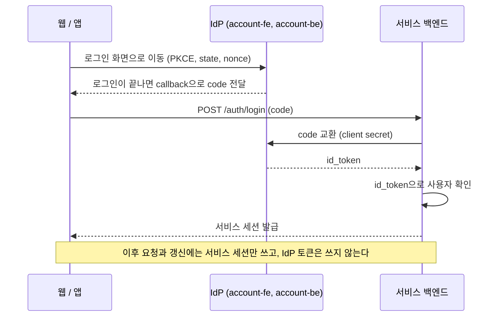

# account-sdk

인포팀 계정(IdP, account.gistory.me)으로 로그인하는 기능을 서비스에 붙이는 SDK.

프론트 SDK는 IdP 로그인과 세션 유지(토큰 갱신, 로그아웃)를 처리하고, 백엔드 SDK는 IdP로 사용자를 확인한다. 서비스 세션은 서비스 백엔드가 [세션 프로토콜](#세션-프로토콜)대로 직접 구현한다.

## 시작 순서

1. IdP에 서비스를 client로 등록한다. [IdP client 등록](#idp-client-등록)
2. 백엔드에 [`@infoteam/account-nest`](packages/nest)나 [`@infoteam/account-server`](packages/server)를 붙이고, [세션 프로토콜](#세션-프로토콜)의 로그인, 갱신, 로그아웃 endpoint를 만든다.
3. 프론트에 [`@infoteam/account-react`](packages/react)나 [`gsainfoteam_account`](packages/flutter)를 붙이고, 2의 백엔드 주소를 넘긴다.

## 패키지

| 패키지                                            | 용도                                                          | 배포    |
| ------------------------------------------------- | ------------------------------------------------------------- | ------- |
| [`@infoteam/account-react`](packages/react)       | React 앱. web을 포함한다                                      | npm     |
| [`@infoteam/account-web`](packages/web)           | React를 쓰지 않는 웹 앱                                       | npm     |
| [`gsainfoteam_account`](packages/flutter)         | Flutter 앱                                                    | pub.dev |
| [`@infoteam/account-nest`](packages/nest)         | NestJS 백엔드. server를 포함한다. 세션은 직접 구현한다        | npm     |
| [`@infoteam/account-server`](packages/server)     | NestJS를 쓰지 않는 Node, Bun 백엔드. 세션은 직접 구현한다     | npm     |
| [`@infoteam/account-core`](packages/core)         | 위 패키지들의 공용 코어. 직접 설치하지 않는다                 | npm     |
| [`@infoteam/account-contract`](packages/contract) | IdP와 SDK가 함께 쓰는 값(scope, 거절 사유). account-be도 쓴다 | npm     |
| [`@infoteam/account-testing`](packages/testing)   | 서비스 백엔드 테스트용 가짜 IdP                               | npm     |

npm 패키지는 [npmjs.com](https://www.npmjs.com/org/infoteam)에 public으로 배포하므로 설치에 인증이 필요 없다.

0.5.1까지는 GitHub Packages에 `@gsainfoteam/account-*`로 배포했다. 옮길 때는 import 경로의 scope를 `@infoteam`으로 바꾸고, 다른 `@gsainfoteam` 패키지를 쓰지 않으면 `.npmrc`의 GitHub Packages 설정과 CI의 `NODE_AUTH_TOKEN`도 지운다.

### IdP client 등록

서비스마다 [account.gistory.me](https://account.gistory.me)에 로그인해서 client 설정 화면에서 한 번 한다.

1. client를 등록한다. redirect URI로 웹 callback(`https://<서비스>/auth/callback`)과 앱 scheme(`pot-g://callback` 같은 형태)을 넣는다.
2. 필수 scope와 선택 scope를 고른다. 사용자는 선택 scope만 거부할 수 있다. 백엔드의 `requiredScopes`에는 필수 scope만 넣는다.
3. 인증 방식을 `client_secret_post`로 정한다. 새로 등록하는 client는 이것이 기본값이다.
4. secret을 받아 서비스 백엔드의 환경 변수에 넣는다.

## 동작 방식

### 로그인 흐름



### 서비스 세션

IdP 로그인이 끝나면 서비스 백엔드가 자기 세션을 발급한다. IdP 토큰은 로그인할 때 사용자를 확인하는 데 한 번만 쓰고, 이후의 API 요청과 로그인 유지에는 서비스 세션만 쓴다.

- **세션:** 로그인 한 번을 가리킨다. 토큰을 갱신해도 유지되고, 로그아웃하면 끝난다.
- **access token:** 서비스 백엔드가 발급한다. 형식은 백엔드가 정하고, 수명은 짧게(15분 정도) 둔다. API 요청마다 붙인다.
- **refresh token:** access token이 만료되면 새로 받는 데 쓴다. 쓸 때마다 새 토큰으로 바꾸고, 이미 쓴 토큰이 다시 오면 그 세션을 끝내는 것을 권장한다. 다만 web SDK는 같은 탭 안에서만 refresh를 한 번으로 묶으므로, 탭 여러 개가 거의 동시에 같은 쿠키로 refresh 할 수 있다. 짧은 유예 시간(예: 10초) 안에 같은 토큰이 다시 오면 이미 발급한 새 토큰 쌍을 돌려주고, 유예 시간이 지난 뒤의 재사용만 탈취로 처리한다.
  웹에서는 JavaScript가 읽을 수 없는 httpOnly 쿠키에, 앱에서는 보안 저장소에 둔다.

IdP 토큰을 서비스 API에 그대로 쓰지 않는 이유는 다음과 같다.

- account-be의 access token에는 대상 client가 없다. 그래서 누구나 등록할 수 있는 다른 client의 토큰으로도 우리 서비스에 로그인할 수 있다. 백엔드가 직접 교환해 받은 id_token으로는 그럴 수 없다.
- IdP 토큰을 오래 쓰려면 `offline_access`가 필요한데, 이 scope를 요청하면 account-fe가 로그인할 때마다 동의 화면을 띄운다.
- 서비스에 필요한 값(예: 기기 id)을 토큰에 함께 실을 수 있고, IdP가 잠깐 멈춰도 이미 로그인한 사용자는 영향을 받지 않는다.

세션은 서비스마다 요구사항(저장소, 토큰 형식, 기기 id 같은 추가 값)이 달라서 SDK가 만들지 않고 서비스 백엔드가 직접 구현한다. 백엔드 SDK는 code 교환과 id_token 검증(`loginWithCode`)까지만 맡는다.

### 세션 프로토콜

프론트 SDK의 `api` 옵션은 서비스 백엔드가 아래 endpoint를 구현했다고 가정한다. 경로는 `{ baseUrl, paths }`로 바꿀 수 있다. 백엔드 형식이 이것과 다르면 웹에서는 `session` 옵션에 백엔드 호출을 직접 구현해서 넘긴다. [`@infoteam/account-web`](packages/web#백엔드-형식이-다를-때) 참고.

모든 요청은 `POST`다. 웹은 쿠키를 보내도록 `credentials: 'include'`로 요청하고, refresh와 logout에는 body가 없다. 앱은 모든 요청에 JSON body와 `transport: 'body'`를 보낸다.

| endpoint        | 요청 body                                                                                                   | 성공 응답                                                                |
| --------------- | ----------------------------------------------------------------------------------------------------------- | ------------------------------------------------------------------------ |
| `/auth/login`   | `{ code, code_verifier, redirect_uri, nonce, iss?, transport }` 또는 `{ ticket, transport }`                | `200 { access_token, expires_in?, refresh_token? }`                      |
| `/auth/refresh` | 웹은 없음(쿠키), 앱은 `{ refresh_token, transport }`                                                        | `200 { access_token, expires_in?, refresh_token? }`, 세션이 없으면 `401` |
| `/auth/logout`  | 웹은 없음(쿠키), 앱은 `{ refresh_token, transport }`. `Authorization: Bearer <access_token>`이 붙을 수 있다 | `2xx`                                                                    |

- **login:** code로 온 요청이면 백엔드는 받은 값으로 `loginWithCode`를 호출한다. code를 IdP와 교환하고, id_token의 `aud`와 `nonce`를 확인한 뒤 사용자를 돌려준다. 그 사용자로 서비스 세션을 만든다. ticket으로 온 요청에는 code가 없으므로 `loginWithCode`를 부르지 않는다. ticket과 추가 입력을 검증하고 ticket의 사용자로 세션을 만든다(아래 "거절과 ticket").
- **transport:** 웹은 `'cookie'`를 보낸다. 백엔드는 refresh token을 httpOnly, `Secure`, `SameSite=Strict` 쿠키(이름 `refresh_token`, path는 refresh와 logout endpoint를 모두 포함하는 경로, 예: `/auth`)로 내려주고 body에는 넣지 않는다. 쿠키를 지울 때도 같은 path와 속성을 쓴다. 앱은 `'body'`를 보내고, 백엔드는 refresh token을 body에 넣는다. login 응답에는 반드시 넣고, refresh에서 토큰을 바꿨다면 refresh 응답에도 새 토큰을 넣는다. refresh 응답에 없으면 앱은 이전 refresh token을 계속 쓴다.
- **거절과 ticket:** 약관 동의처럼 로그인 전에 사용자 입력이 더 필요하면 `403 { error: 'session_rejected', ticket, details }`로 거절한다. code는 한 번만 교환할 수 있으므로, `ticket`에는 백엔드가 이미 확인한 사용자를 담는다(짧은 수명. 서명이나 MAC, 또는 인증된 암호화(AEAD)로 무결성과 출처를 반드시 확인한다). 클라이언트는 `{ ticket, ...추가 입력 }`으로 login을 다시 호출한다. 세션을 발급할 때 ticket을 원자적으로 소비해서(사용한 ticket을 기록) 다시 쓰지 못하게 한다. 다시 403으로 거절할 때는 ticket을 소비하지 않고 응답에 ticket을 다시 담는다. 클라이언트는 마지막 거절 응답의 ticket으로 재시도한다. 403이 아닌 실패(400, 401, 5xx)는 거절이 아니라 오류로 처리된다.
- **CORS:** 프론트와 백엔드의 origin이 다르면 프론트 origin을 허용하고 `credentials: true`로 설정한다. `SameSite=Strict` 쿠키는 같은 site(예: `ziggle.gistory.me`와 `api.ziggle.gistory.me`)에서만 오가므로, 프론트와 백엔드는 같은 등록 도메인 아래에 둔다.
- **CSRF:** 쿠키를 쓰는 세 endpoint는 `Origin` 헤더가 있으면 프론트 origin과 같은지 확인한다. 같은 site의 다른 서브도메인이 보낸 form 요청을 막는다. 앱은 `Origin`을 보내지 않는다.

[`examples/nest`](examples/nest)에 이 프로토콜을 메모리 저장소로 줄여 구현한 예제가 있다. refresh token 만료, 재사용된 refresh token의 세션 폐기, 여러 탭을 위한 유예 시간, ticket 흐름은 빠져 있으므로 실제 서비스에서는 직접 구현한다.

### 로그아웃

로그인 상태는 두 겹이다. 서비스 세션과, account-fe에 남아 있는 IdP 로그인 세션이다.

- **`logout()`:** 서비스 세션만 끝낸다. 로그인 상태를 바로 지우고 백엔드에 로그아웃을 요청하며, 이 요청이 실패해도 에러를 던지지 않는다. 이때 서버 세션과 refresh 쿠키가 남아서, 페이지를 다시 열면 세션이 복구될 수 있다. 다음 로그인에서는 IdP 로그인 화면을 다시 띄워서, 같은 브라우저에서 다른 계정으로 바꿀 수 있게 한다.
- **`logout({ idp: true })`:** IdP 로그인 세션까지 끝낸다. 공용 PC처럼 계정을 남기면 안 되는 경우에 쓴다. 이미 로그인한 다른 서비스의 세션은 그대로 남고, 그 뒤에 새로 로그인하는 서비스는 IdP 로그인을 다시 거친다. IdP가 로그아웃 endpoint를 제공하지 않으면 서비스 세션만 끝낸다.

## 개발

[mise](https://mise.jdx.dev)로 Node, pnpm, Flutter 버전을 맞춘다.

```bash
mise install
pnpm install
```

```bash
pnpm build          # 모든 npm 패키지 빌드 (turbo)
pnpm typecheck
pnpm lint
pnpm test           # 단위 테스트. IdP 에 요청하지 않는다
pnpm format         # prettier 검사
pnpm examples:build # examples 빌드

mise run check      # typecheck, lint, build, test 를 차례로 실행
mise run test:live  # 운영과 스테이징 IdP 에 실제로 요청하는 테스트
pnpm contract:dart  # packages/contract 에서 Dart enum 다시 생성
```

Flutter 패키지는 `packages/flutter`에서 `flutter analyze`와 `flutter test`로 검사한다.

### 구조

- IdP 주소와 경로는 discovery(`/.well-known/openid-configuration`)에서 가져온다. account-be의 discovery 문서에 있는 결함은 `normalizeDiscovery` 한 곳에서만 보정한다.
- 여러 언어가 함께 쓰는 값(IdP 주소, 경로, 저장소 키 namespace)은 [`packages/core/src/constants/idp.json`](packages/core/src/constants/idp.json)에 둔다.
  Flutter 패키지는 테스트로 이 파일과 값이 같은지 확인한다.
- scope와 거절 사유, scope별 사용자 필드(`SCOPE_CLAIMS`)는 [`@infoteam/account-contract`](packages/contract)에 둔다. account-be와 SDK가 모두 이 패키지를 import 하고,
  Dart enum은 `pnpm contract:dart`가 여기서 생성한다.

### 스테이징 로그인 확인

[`examples/web`](examples/web)(Vite, React, TanStack Router)과 [`examples/nest`](examples/nest)(CommonJS로 빌드한 Nest 백엔드)를 함께 띄우면 로그인 흐름 전체를 확인할 수 있다.

1. 스테이징 IdP([stg.account.gistory.me](https://stg.account.gistory.me))에 client를 등록하고, redirect URI로 `http://localhost:5173/auth/callback`을 넣는다. `examples/nest`가 `requiredScopes: ['name']`으로 선언되어 있으므로 `name`은 필수 scope로 등록한다.
2. `.env.example`을 `.env`로 복사하고 client id와 secret을 채운다. mise가 `.env`를 읽어 각 task에 넣어 준다.
3. `mise run example:api`와 `mise run example:web`을 각각 띄우고 http://localhost:5173 을 연다.

### 배포

[changesets](https://github.com/changesets/changesets)로 버전을 올린다. `account-contract`를 뺀 모든 패키지가 같은 버전을 쓴다.

```bash
pnpm changeset           # 변경 기록
pnpm version:packages    # 버전 반영. Flutter pubspec 도 같은 버전으로 맞춘다
```

`v*` 태그를 push 하면 GitHub Actions가 npm 패키지를 npmjs.com에, Flutter 패키지를 pub.dev에 배포한다. npm 배포는 토큰 없이
[Trusted Publishing](https://docs.npmjs.com/trusted-publishers)(GitHub Actions OIDC)으로 하고, provenance가 함께 붙는다.

새 npm 패키지를 추가하면 한 번은 직접 설정해야 한다. Trusted Publishing은 이미 있는 패키지에만 설정할 수 있다.

1. `infoteam` 조직 권한이 있는 계정으로 `npm login` 하고 루트에서 `pnpm build`를 한 뒤, 그 패키지 디렉터리에서 `pnpm publish --access public`으로 첫 버전을 올린다. 모든 패키지를 처음 옮길 때는 루트에서 `pnpm build && pnpm -r publish --access public`으로 한 번에 올린다.
2. npmjs.com의 패키지 Settings에서 Trusted Publisher로 GitHub Actions를 추가한다. 조직은 `gsainfoteam`, 저장소는 `account-sdk`, workflow는 `release.yml`, environment는 `npm`이다. Allowed actions에서 `npm publish`(직접 배포)를 허용한다. 허용하지 않으면 staged publish만 가능해서 `changeset publish`가 실패한다. 저장한 설정은 2일 안에 첫 배포가 성공하지 않으면 만료된다.
3. 같은 화면에서 Publishing access를 "Require two-factor authentication and disallow tokens"로 바꾼다.

배포 job은 GitHub environment `npm`에서 돌고, Trusted Publisher도 이 environment에 묶는다. 저장소 Settings → Environments → `npm`에 required reviewers와 `v*` 태그만 허용하는 deployment rule을 두면, 승인 없이는 npm에 배포되지 않는다.
