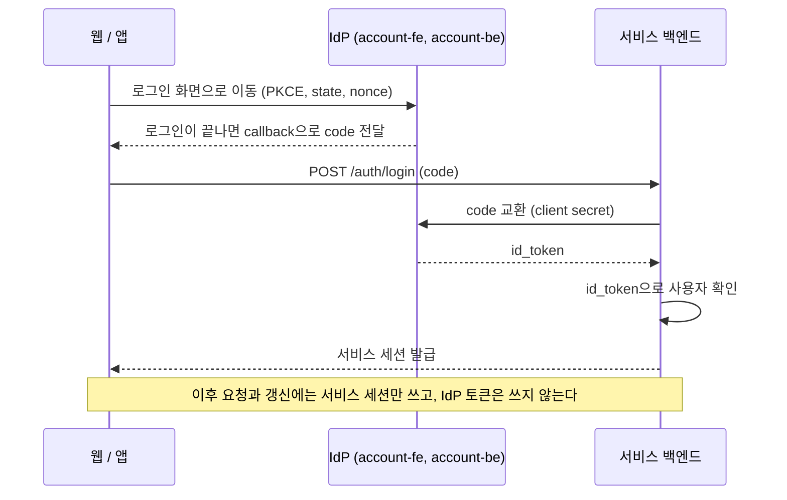

# account-sdk

인포팀 계정(IdP, account.gistory.me)으로 로그인하는 기능을 서비스에 붙이는 SDK.

서비스는 IdP 환경과 client id만 넘긴다. IdP 로그인, 로그인 유지, 토큰 갱신, 로그아웃은 SDK가 처리한다.

## 시작 순서

1. IdP에 서비스를 client로 등록한다. [IdP client 등록](#idp-client-등록)
2. npm 패키지를 받을 수 있도록 인증을 설정한다. [설치 인증](#설치-인증)
3. 백엔드에 [`@gsainfoteam/account-nest`](packages/nest)를 붙인다. 로그인, 갱신, 로그아웃 endpoint가 생긴다.
4. 프론트에 [`@gsainfoteam/account-react`](packages/react)나 [`gsainfoteam_account`](packages/flutter)를 붙이고, 3의 백엔드 주소를 넘긴다.

## 패키지

| 패키지                                               | 용도                                                          | 배포            |
| ---------------------------------------------------- | ------------------------------------------------------------- | --------------- |
| [`@gsainfoteam/account-react`](packages/react)       | React 앱. web을 포함한다                                      | GitHub Packages |
| [`@gsainfoteam/account-web`](packages/web)           | React를 쓰지 않는 웹 앱                                       | GitHub Packages |
| [`gsainfoteam_account`](packages/flutter)            | Flutter 앱                                                    | pub.dev         |
| [`@gsainfoteam/account-nest`](packages/nest)         | NestJS 백엔드. server를 포함한다                              | GitHub Packages |
| [`@gsainfoteam/account-server`](packages/server)     | NestJS를 쓰지 않는 Node, Bun 백엔드. 세션은 직접 구현한다     | GitHub Packages |
| [`@gsainfoteam/account-core`](packages/core)         | 위 패키지들의 공용 코어. 직접 설치하지 않는다                 | GitHub Packages |
| [`@gsainfoteam/account-contract`](packages/contract) | IdP와 SDK가 함께 쓰는 값(scope, 거절 사유). account-be도 쓴다 | GitHub Packages |

### 설치 인증

npm 패키지는 GitHub Packages에서 받는다. GitHub Packages는 public 패키지도 인증 없이는 설치할 수 없으므로, 서비스 프로젝트 루트에 `.npmrc`를 둔다.

```ini
@gsainfoteam:registry=https://npm.pkg.github.com
//npm.pkg.github.com/:_authToken=${NODE_AUTH_TOKEN}
```

첫 줄은 `@gsainfoteam` 패키지를 GitHub Packages에서 받게 하고, 둘째 줄은 그때 쓸 토큰을 정한다. `NODE_AUTH_TOKEN`에는 `read:packages` 권한이 있는 토큰을 넣는다.

```bash
gh auth refresh -s read:packages
export NODE_AUTH_TOKEN=$(gh auth token)
```

GitHub Actions에서는 `secrets.GITHUB_TOKEN`을 쓰고 `permissions`에 `packages: read`를 넣는다.

### IdP client 등록

서비스마다 account-fe의 client 설정 화면에서 한 번 한다.

1. client를 등록한다. redirect URI로 웹 callback(`https://<서비스>/auth/callback`)과 앱 scheme(`pot-g://callback` 같은 형태)을 넣는다.
2. 필수 scope와 선택 scope를 고른다. 사용자는 선택 scope만 거부할 수 있다. 백엔드의 `requiredScopes`에는 필수 scope만 넣는다.
3. 인증 방식을 `client_secret_post`로 정한다. 새로 등록하는 client는 이것이 기본값이다.
4. secret을 받아 서비스 백엔드의 환경 변수에 넣는다.

## 동작 방식

### 로그인 흐름



### 서비스 세션

IdP 로그인이 끝나면 서비스 백엔드가 자기 세션을 발급한다. IdP 토큰은 로그인할 때 사용자를 확인하는 데 한 번만 쓰고, 이후의 API 요청과 로그인 유지에는 서비스 세션만 쓴다.

- **세션:** 로그인 한 번을 가리킨다. 토큰을 갱신해도 유지되고, 로그아웃하면 끝난다.
- **access token:** 서비스 백엔드가 서명한 JWT로, 수명은 15분이다. API 요청마다 붙인다.
- **refresh token:** access token이 만료되면 새로 받는 데 쓴다. 쓸 때마다 새 토큰으로 바뀌고, 이미 쓴 토큰이 다시 오면 탈취된 것으로 보고 그 세션을 끝낸다.
  웹에서는 JavaScript가 읽을 수 없는 httpOnly 쿠키에, 앱에서는 보안 저장소에 둔다.

IdP 토큰을 서비스 API에 그대로 쓰지 않는 이유는 다음과 같다.

- account-be의 access token에는 대상 client가 없다. 그래서 누구나 등록할 수 있는 다른 client의 토큰으로도 우리 서비스에 로그인할 수 있다. 백엔드가 직접 교환해 받은 id_token으로는 그럴 수 없다.
- IdP 토큰을 오래 쓰려면 `offline_access`가 필요한데, 이 scope를 요청하면 account-fe가 로그인할 때마다 동의 화면을 띄운다.
- 서비스에 필요한 값(예: 기기 id)을 토큰에 함께 실을 수 있고, IdP가 잠깐 멈춰도 이미 로그인한 사용자는 영향을 받지 않는다.

서비스가 직접 작성하는 것은 IdP 사용자를 자기 DB의 사용자와 연결하는 함수 하나와, 세션을 저장할 store다. 나머지는 nest 세션 모듈과 프론트 SDK가 맡는다.

### 로그아웃

로그인 상태는 두 겹이다. 서비스 세션과, account-fe에 남아 있는 IdP 로그인 세션이다.

- **`logout()`:** 서비스 세션만 끝낸다. 다음 로그인에서는 IdP 로그인 화면을 다시 띄워서, 같은 브라우저에서 다른 계정으로 바꿀 수 있게 한다.
- **`logout({ idp: true })`:** IdP 로그인 세션까지 끝낸다. 공용 PC처럼 계정을 남기면 안 되는 경우에 쓴다. 이 경우 같은 IdP를 쓰는 다른 서비스에서도 다시 로그인해야 한다.

## 개발

[mise](https://mise.jdx.dev)로 Node, pnpm, Flutter 버전을 맞춘다.

```bash
mise install
pnpm install
```

```bash
pnpm build          # 모든 npm 패키지 빌드 (turbo)
pnpm typecheck
pnpm lint
pnpm test           # 단위 테스트. IdP 에 요청하지 않는다
pnpm format         # prettier 검사
pnpm examples:build # examples 빌드

mise run check      # 위 검사를 CI 와 같은 순서로 실행
mise run test:live  # 운영과 스테이징 IdP 에 실제로 요청하는 테스트
pnpm contract:dart  # packages/contract 에서 Dart enum 다시 생성
```

Flutter 패키지는 `packages/flutter`에서 `flutter analyze`와 `flutter test`로 검사한다.

### 구조

- IdP 주소와 경로는 discovery(`/.well-known/openid-configuration`)에서 가져온다. account-be의 discovery 문서에 있는 결함은 `normalizeDiscovery` 한 곳에서만 보정한다.
- 여러 언어가 함께 쓰는 값(IdP 주소, 경로, 저장소 키 namespace)은 [`packages/core/src/constants/idp.json`](packages/core/src/constants/idp.json)에 둔다.
  Flutter 패키지는 테스트로 이 파일과 값이 같은지 확인한다.
- scope와 거절 사유, scope별 사용자 필드(`SCOPE_CLAIMS`)는 [`@gsainfoteam/account-contract`](packages/contract)에 둔다. account-be와 SDK가 모두 이 패키지를 import 하고,
  Dart enum은 `pnpm contract:dart`가 여기서 생성한다.

### 스테이징 로그인 확인

[`examples/web`](examples/web)(Vite, React, TanStack Router)과 [`examples/nest`](examples/nest)(CommonJS로 빌드한 Nest 백엔드)를 함께 띄우면 로그인 흐름 전체를 확인할 수 있다.

1. 스테이징 IdP에 client를 등록하고, redirect URI로 `http://localhost:5173/auth/callback`을 넣는다. `examples/nest`가 `requiredScopes: ['name']`으로 선언되어 있으므로 `name`은 필수 scope로 등록한다.
2. `.env.example`을 `.env`로 복사하고 client id와 secret을 채운다. mise가 `.env`를 읽어 각 task에 넣어 준다.
3. `mise run example:api`와 `mise run example:web`을 각각 띄우고 http://localhost:5173 을 연다.

### 배포

[changesets](https://github.com/changesets/changesets)로 버전을 올린다. 모든 패키지가 같은 버전을 쓴다.

```bash
pnpm changeset           # 변경 기록
pnpm version:packages    # 버전 반영. Flutter pubspec 도 같은 버전으로 맞춘다
```

`v*` 태그를 push 하면 GitHub Actions가 npm 패키지를 GitHub Packages에, Flutter 패키지를 pub.dev에 배포한다.
