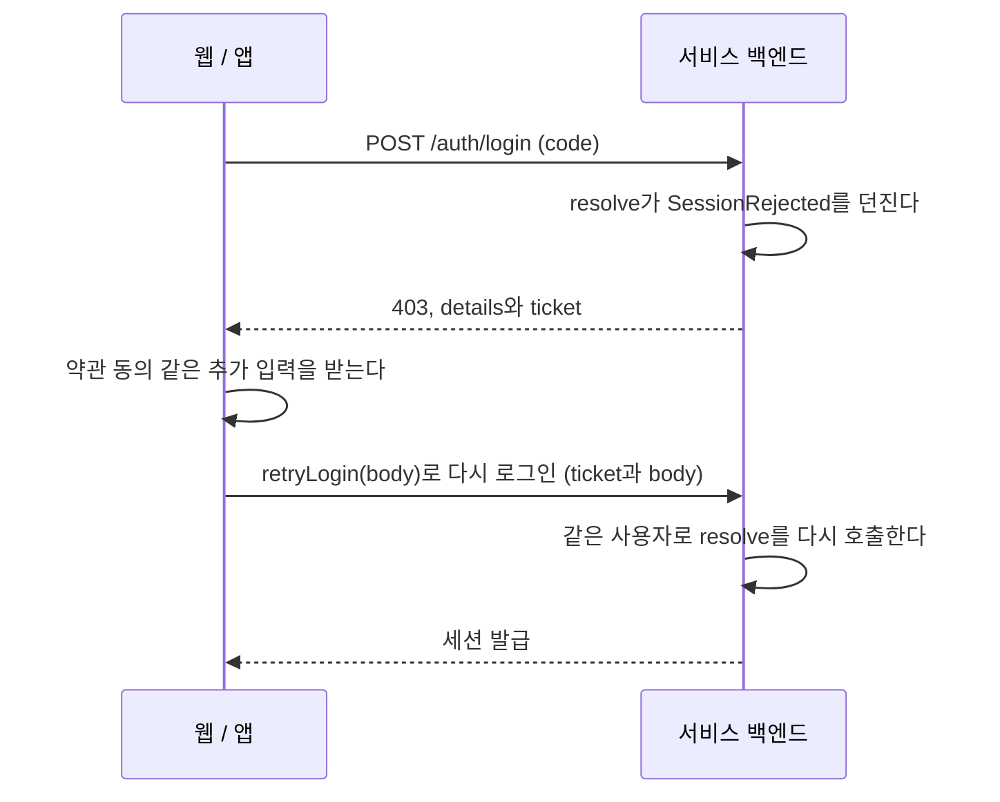

# @gsainfoteam/account-nest

NestJS 백엔드를 인포팀 계정(IdP)에 붙인다. 모듈 하나로 로그인, 갱신, 로그아웃 endpoint와 guard가 생기므로, 서비스는 IdP 사용자를 자기 DB의
사용자와 연결하는 함수만 작성하면 된다. 서비스 세션이 무엇이고 왜 쓰는지는 [루트 README](../../README.md#서비스-세션)에 있다.

ziggle-be, house-moving-out-be, pot-g-be가 각자 갖고 있던 `infoteam-idp` 라이브러리와 login, refresh, logout 구현을 대신한다.

## 설치

GitHub Packages에서 배포한다. 먼저 [설치 인증](../../README.md#설치-인증)을 설정한다.

```bash
pnpm add @gsainfoteam/account-nest zod
```

ESM으로만 배포한다. CommonJS(`module: commonjs`)로 빌드하는 Nest 앱도 Node 20.19 이상이면 `require()`로 그대로 불러온다.

jest는 ESM을 `require()` 하지 못하므로, SDK와 그 의존성(jose, oauth4webapi)만 변환하도록 설정한다.

```js
// jest 설정
transform: { '^.+\\.(t|j)s$': ['ts-jest', { tsconfig: { allowJs: true } }] },
transformIgnorePatterns: ['/node_modules/(?!\\.pnpm|@gsainfoteam|jose|oauth4webapi)'],
```

## 모듈 설정

설정은 두 군데로 나뉜다. 타입을 정하는 정적인 값(scope, 세션 claim의 모양)은 `defineAccount`에 두고, 환경마다 다르거나 다른 provider를 주입받아야
하는 값(secret, store, 사용자 연결)은 `forRootAsync`에 둔다.

```ts
// account.ts
import { defineAccount, type SessionOf } from '@gsainfoteam/account-nest';
import { z } from 'zod';

export const account = defineAccount({
  requiredScopes: ['name', 'email'], // client 에 필수로 등록한 scope
  session: { claims: z.object({ devicePk: z.number() }) }, // access token 에 실을 값. 없으면 session: {}
});
export const { AccountModule, AccountService, SessionGuard, OptionalSessionGuard } = account;
export type AccountService = InstanceType<typeof AccountService>;
export type Session = SessionOf<typeof account>;
```

```ts
// app.module.ts
AccountModule.forRootAsync({
  isGlobal: true,
  imports: [UsersModule],
  inject: [ConfigService, UsersService, PrismaService],
  useFactory: (config: ConfigService, users: UsersService, prisma: PrismaService) => ({
    issuer: 'production',
    clientId: config.getOrThrow('ACCOUNT_CLIENT_ID'),
    clientSecret: config.getOrThrow('ACCOUNT_CLIENT_SECRET'),
    session: {
      secret: config.getOrThrow('SESSION_SECRET'),
      store: prismaSessionStore(prisma.accountSession),
      resolve: async (user, { body }) => {
        const local = await users.upsertByIdp(user); // user.email 은 string
        return { subject: local.id, claims: { devicePk: Number(body.device_id) } };
      },
    },
  }),
}),
```

```ts
// 보호할 라우트
import { CurrentSession } from '@gsainfoteam/account-nest';

@Get('me')
@UseGuards(SessionGuard)
me(@CurrentSession() session: Session) {
  return session.sub; // resolve 가 돌려준 subject. session.sid, session.devicePk 도 있다
}
```

- `export type AccountService` 줄은 반드시 함께 쓴다. 이 줄이 있어야 구조 분해로 꺼낸 클래스를 타입으로 쓸 수 있고, `@Inject` 없이 생성자 타입만으로 주입된다.
- guard를 다른 모듈의 controller에서 쓰려면 `isGlobal: true`로 등록한다.
- `OptionalSessionGuard`는 로그인하지 않은 요청도 통과시키고, 이때 `@CurrentSession()`은 `undefined`다.
- 앱이 시작될 때 IdP에 등록한 client 정보를 읽어 `requiredScopes`, `clientCredentialsScopes`, 인증 방식(`client_secret_post`)이 맞는지 확인한다.
  맞지 않으면 앱이 시작되지 않는다. `verifyRegistration: 'warn'`이면 로그만 남긴다. IdP에 연결하지 못했을 때도 로그만 남긴다.

## 서비스 세션

`session`을 정의하면 모듈에 다음 endpoint가 생긴다. 웹과 Flutter SDK가 이 endpoint를 호출하므로 서비스가 직접 부를 일은 없다.

| endpoint             | 동작                                                                                                    |
| -------------------- | ------------------------------------------------------------------------------------------------------- |
| `POST /auth/login`   | 프론트가 보낸 code를 IdP와 교환하고, id_token으로 사용자를 확인한 뒤 `resolve`를 호출해 세션을 발급한다 |
| `POST /auth/refresh` | refresh token을 새 토큰으로 바꾸고 access token을 다시 발급한다                                         |
| `POST /auth/logout`  | 세션을 끝낸다                                                                                           |

경로를 바꾸려면 `defineAccount`의 `session: { paths: { refresh: '/auth/refresh-token' } }`처럼 준다.

### 옵션

`forRootAsync`의 `session`에 준다.

| 옵션         | 설명                                                                                                         |
| ------------ | ------------------------------------------------------------------------------------------------------------ |
| `secret`     | 32자 이상. access token 서명과 ticket 암호화에 쓴다                                                          |
| `store`      | 세션을 저장할 곳. 아래 [store](#store) 참고                                                                  |
| `resolve`    | IdP 사용자를 받아 `{ subject, claims }`를 돌려준다. `subject`는 서비스 DB의 사용자 id다                      |
| `onLogin`    | `'replace'`이면 로그인할 때 같은 사용자의 다른 세션을 모두 끝낸다(한 기기에서만 로그인). 기본값은 `'add'`    |
| `accessTtl`  | access token 수명(초). 기본값은 15분                                                                         |
| `refreshTtl` | refresh token 수명(초). 토큰을 교체할 때마다 다시 센다. 기본값은 30일                                        |
| `cookie`     | 쿠키 이름, `sameSite`, `secure`, `domain`. 기본값은 `refresh_token`, `HttpOnly`, `Secure`, `SameSite=Strict` |

`resolve`의 `body`에는 로그인 요청 body에서 프로토콜 필드(`code`, `code_verifier` 등)를 뺀 나머지가 들어온다. 앱이 보낸 기기 id 같은 값을 여기서 읽는다.

### 동작

- **access token:** HS256 JWT다. `sub`(resolve가 돌려준 subject), `sid`(세션 id), `claims`가 들어간다.
- **refresh token:** refresh 할 때마다 교체한다. 이미 쓰인 토큰이 다시 오면 그 세션의 토큰을 모두 지운다. 탭 두 개가 동시에 refresh 하는 경우를 위해 10초의 유예 시간을 둔다.
- **전달 방식:** 웹은 쿠키로, 앱(`transport: 'body'`)은 body로 주고받는다. 프론트 SDK가 알아서 고른다. Express와 Fastify에서 모두 동작한다.
- **WebSocket 등:** guard를 쓸 수 없는 곳에서는 `account.verifySession(accessToken)`을 호출한다.
- **최근 재인증:** 세션에는 사용자가 IdP에 로그인한 시각(`auth_time`, 초)과 방식(`amr`: 비밀번호 `pwd`, 패스키 `hwk`)이 담긴다. refresh 해도 처음 로그인한
  값이 유지된다. 민감한 작업 전에 이 값을 확인하고, 조건에 맞지 않으면 프론트가 `login({ prompt: 'login' })`으로 다시 로그인하게 한다.

### 로그인 전 추가 입력

약관 동의처럼 로그인을 마치기 전에 사용자에게 더 받아야 할 것이 있으면, `resolve`에서 `throw new SessionRejected(details)` 한다.
SDK가 이미 확인한 사용자를 ticket에 담아 프론트에 돌려주므로, 재시도할 때는 IdP를 다시 거치지 않는다. ticket은 5분 동안 유효하다.



### store

store에는 refresh token을 저장한다. 토큰 자체가 아니라 SHA-256 해시를 저장하며, refresh 할 때 토큰을 찾고 재사용을 감지하는 데 쓴다.
서버를 재시작하거나 여러 대 띄워도 로그인이 유지되어야 하므로 운영에서는 DB나 Redis를 쓴다.

| store                  | 로그아웃한 세션의 access token | 만료된 토큰                |
| ---------------------- | ------------------------------ | -------------------------- |
| `prismaSessionStore`   | 만료될 때까지(기본 15분) 통과  | 직접 지운다                |
| `redisSessionStore`    | 바로 막힌다                    | 자동으로 지워진다          |
| `memorySessionStore()` | 바로 막힌다                    | 프로세스가 끝나면 사라진다 |

`memorySessionStore()`는 테스트와 서버를 한 대만 띄우는 개발 환경에서만 쓴다.

Prisma를 쓰면 모델을 추가하고 `prismaSessionStore(prisma.accountSession)`를 넘긴다.

```prisma
model AccountSession {
  tokenHash String    @id
  sessionId String
  subject   String
  claims    Json
  expiresAt DateTime
  usedAt    DateTime?

  @@index([sessionId])
  @@index([subject])
  @@index([expiresAt])
}
```

만료된 행은 자동으로 지워지지 않으므로 `prisma.accountSession.deleteMany({ where: { expiresAt: { lt: new Date() } } })`를 주기적으로 실행한다.

Redis(ioredis)를 쓰면 `redisSessionStore(redis)`를 넘긴다. 키마다 refresh token의 만료 시각을 TTL로 걸어 두므로 따로 지울 필요가 없다.
대신 guard가 요청마다 `EXISTS`를 한 번 호출한다. 키 접두사는 `{ prefix }`로 바꾸며, 기본값은 `account-session:`이다.

다른 저장소라면 `SessionStore`를 구현한다. `markUsed`는 원자적이어야 한다. 동시에 온 refresh 요청 중 하나만 성공해야 재사용을 감지할 수 있기
때문이다. `isActive(sessionId)`는 선택이다. 구현하면 guard가 요청마다 이 메서드를 불러서, 로그아웃한 세션의 access token을 만료 전에도 막는다.

Drizzle(PostgreSQL)이면 다음과 같이 구현한다. node-postgres와 postgres.js 드라이버에서 모두 동작한다. 만료된 행은 Prisma처럼 주기적으로 지운다.

```ts
import { type SessionRecord, type SessionStore } from '@gsainfoteam/account-nest';
import { and, eq, isNull, lt } from 'drizzle-orm';
import {
  index,
  jsonb,
  pgTable,
  text,
  timestamp,
  type PgDatabase,
  type PgQueryResultHKT,
} from 'drizzle-orm/pg-core';

export const accountSession = pgTable(
  'account_session',
  {
    tokenHash: text('token_hash').primaryKey(),
    sessionId: text('session_id').notNull(),
    subject: text('subject').notNull(),
    claims: jsonb('claims').$type<SessionRecord['claims']>().notNull(),
    expiresAt: timestamp('expires_at', { withTimezone: true }).notNull(),
    usedAt: timestamp('used_at', { withTimezone: true }),
  },
  (table) => [
    index('account_session_session_id_idx').on(table.sessionId),
    index('account_session_subject_idx').on(table.subject),
    index('account_session_expires_at_idx').on(table.expiresAt),
  ],
);

export function drizzleSessionStore<Schema extends Record<string, unknown>>(
  db: PgDatabase<PgQueryResultHKT, Schema>,
): SessionStore {
  return {
    async save(record) {
      await db.insert(accountSession).values(record);
    },

    async find(tokenHash) {
      const [row] = await db
        .select()
        .from(accountSession)
        .where(eq(accountSession.tokenHash, tokenHash));
      return row ?? null;
    },

    async markUsed(tokenHash, at) {
      const marked = await db
        .update(accountSession)
        .set({ usedAt: at })
        .where(and(eq(accountSession.tokenHash, tokenHash), isNull(accountSession.usedAt)))
        .returning({ tokenHash: accountSession.tokenHash });
      return marked.length > 0;
    },

    async deleteUsed(sessionId, before) {
      await db
        .delete(accountSession)
        .where(and(eq(accountSession.sessionId, sessionId), lt(accountSession.usedAt, before)));
    },

    async deleteSession(sessionId) {
      await db.delete(accountSession).where(eq(accountSession.sessionId, sessionId));
    },

    async deleteSubject(subject) {
      await db.delete(accountSession).where(eq(accountSession.subject, subject));
    },
  };
}
```

## scope와 필드 타입

`requiredScopes`에 넣은 scope의 필드는 `resolve`가 받는 사용자에서 필수 타입이 된다. 예를 들어 `email`을 넣으면 `user.email`은 `string`이다.
id_token에 그 필드가 빠져 있으면 SDK가 `missing_claims`로 실패하므로, `undefined`가 서비스 코드까지 전달되지 않는다.

`requiredScopes`에는 client에 **필수로** 등록한 scope만 넣는다. 사용자가 거부할 수 있는 선택 scope를 넣으면, 그 scope를 거부한 사용자는 로그인하지 못한다.

scope 구성이 다른 설정이 여러 개 필요하면(예: 사용자 앱과 관리자 웹) `defineAccount`를 여러 번 호출한다. 호출할 때마다 주입 토큰과 endpoint가 따로
생기므로, 두 번째부터는 `paths`를 다르게 준다.

## 세션 없이 쓰기

`session`을 빼면 endpoint 없이 IdP 클라이언트만 주입받는다. 다른 사용자의 정보를 조회할 때처럼 IdP에 직접 요청해야 할 때 쓴다.

```ts
constructor(private readonly account: AccountService) {}

findUser(sub: string) {
  return this.account.getUserInfoBySub(sub); // clientSecret 과 clientCredentialsScopes 가 필요하다
}
```

메서드 목록은 [`@gsainfoteam/account-server` README](../server/README.md)에 있다.

## 에러

SDK는 실패하면 `AccountError`를 던지므로 `code`로 경우를 나눈다. 세션 endpoint는 이 에러를 HTTP 상태로 바꿔 응답한다. 예를 들어 `invalid_grant`는
401, IdP 장애는 502다.

## 테스트

[`@gsainfoteam/account-testing`](../testing)의 가짜 IdP로 진짜 IdP 없이 `/auth/login`부터 guard까지 e2e 테스트를 돌린다.

전체 예시는 [`examples/nest`](../../examples/nest)에 있다.
