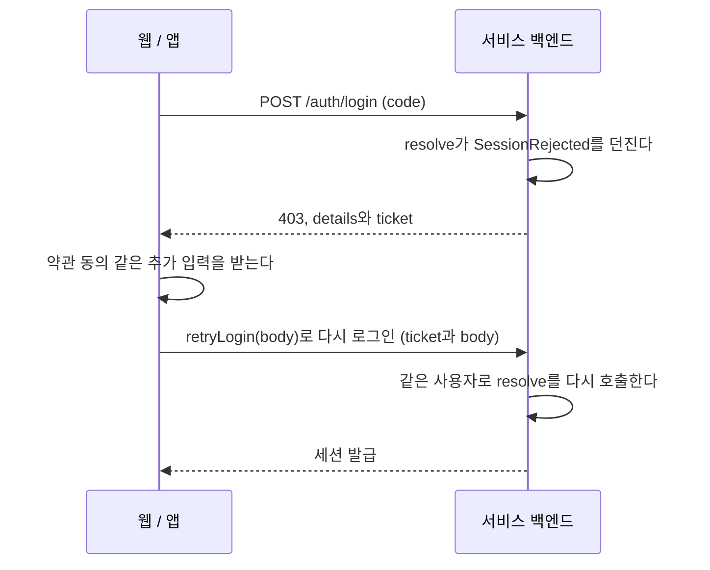

# @gsainfoteam/account-nest

NestJS 백엔드를 인포팀 계정(IdP)에 붙인다. [`@gsainfoteam/account-server`](../server)를 Nest 모듈로 감쌌다.
ziggle-be, house-moving-out-be, pot-g-be가 각자 갖고 있던 `infoteam-idp` 라이브러리를 대신한다.

## 설치

GitHub Packages에서 배포한다. 먼저 [설치 인증](../../README.md#설치-인증)을 설정한다.

```bash
pnpm add @gsainfoteam/account-nest zod
```

ESM으로만 배포한다. CommonJS(`module: commonjs`)로 빌드하는 Nest 앱도 Node 20.19 이상이면 `require()`로 그대로 불러온다.

jest는 ESM을 `require()` 하지 못하므로, SDK와 그 의존성(jose, oauth4webapi)만 변환하도록 설정한다.

```js
// jest 설정
transform: { '^.+\\.(t|j)s$': ['ts-jest', { tsconfig: { allowJs: true } }] },
transformIgnorePatterns: ['/node_modules/(?!\\.pnpm|@gsainfoteam|jose|oauth4webapi)'],
```

## 등록

정적인 값(scope, 세션 claim의 모양)은 `defineAccount`에, 환경마다 다르거나 DI가 필요한 값(secret, store, 사용자 저장)은 `forRootAsync`에 둔다.

```ts
// account.ts
import { defineAccount, type SessionOf } from '@gsainfoteam/account-nest';
import { z } from 'zod';

export const account = defineAccount({
  requiredScopes: ['name', 'email'], // client 에 필수로 등록한 scope
  session: { claims: z.object({ devicePk: z.number() }) }, // 선택. access token 에 실을 값
});
export const { AccountModule, AccountService, SessionGuard, OptionalSessionGuard } = account;
export type AccountService = InstanceType<typeof AccountService>;
export type Session = SessionOf<typeof account>;
```

```ts
// app.module.ts
AccountModule.forRootAsync({
  isGlobal: true,
  imports: [UsersModule],
  inject: [ConfigService, UsersService, PrismaService],
  useFactory: (config: ConfigService, users: UsersService, prisma: PrismaService) => ({
    issuer: 'production',
    clientId: config.getOrThrow('ACCOUNT_CLIENT_ID'),
    clientSecret: config.getOrThrow('ACCOUNT_CLIENT_SECRET'),
    session: {
      secret: config.getOrThrow('SESSION_SECRET'), // 32자 이상
      store: prismaSessionStore(prisma.accountSession),
      resolve: async (user, { body }) => {
        const local = await users.upsertByIdp(user); // user.email 은 string
        return { subject: local.id, claims: { devicePk: Number(body.device_id) } };
      },
    },
  }),
}),
```

```ts
// 보호할 라우트
@Get('me')
@UseGuards(SessionGuard)
me(@CurrentSession() session: Session) {
  return session.sub; // resolve 가 돌려준 subject. session.sid, session.devicePk 도 있다
}
```

- `export type AccountService` 줄은 반드시 함께 쓴다. 이 줄이 있어야 구조 분해로 꺼낸 클래스를 타입으로 쓸 수 있고, `@Inject` 없이 생성자 타입만으로 주입된다.
- guard를 다른 모듈의 controller에서 쓰려면 `isGlobal: true`로 등록한다.
- 앱이 뜰 때 IdP에 등록한 client 정보를 읽어 `requiredScopes`, `clientCredentialsScopes`, 인증 방식(`client_secret_post`)이 맞는지 확인한다.
  맞지 않으면 앱이 뜨지 않는다. `verifyRegistration: 'warn'`이면 로그만 남긴다. IdP에 연결하지 못했을 때도 로그만 남긴다.

## 서비스 세션

`session`을 정의하면 모듈에 `POST /auth/login`, `/auth/refresh`, `/auth/logout`이 생긴다. 웹과 Flutter SDK가 이 endpoint를 호출한다.
경로를 바꾸려면 `session: { paths: { refresh: '/auth/refresh-token' } }`처럼 준다.

- **로그인:** 프론트가 보낸 code를 교환하고 id_token으로 사용자를 확인한 뒤 `resolve`를 호출한다. body에서 프로토콜 필드(`code`, `code_verifier` 등)를 뺀 나머지가 `resolve`의 `body`로 전달된다.
- **access token:** HS256 JWT이고 기본 수명은 15분이다. `sub`(resolve가 돌려준 subject), `sid`, `claims`가 들어간다.
- **refresh token:** refresh 할 때마다 교체한다. 이미 쓰인 토큰이 다시 오면 그 로그인의 토큰을 모두 지운다. 탭 두 개가 동시에 refresh 하는 경우를 위해 10초의 유예 시간을 둔다.
- **전달 방식:** 웹은 `HttpOnly; Secure; SameSite=Strict` 쿠키로, 앱(`transport: 'body'`)은 body로 주고받는다. Express와 Fastify에서 모두 동작한다.
- **로그인 전 추가 입력:** 아래 [로그인 전 추가 입력](#로그인-전-추가-입력)을 참고한다.
- **단일 세션:** `onLogin: 'replace'`이면 로그인할 때 같은 subject의 다른 세션을 모두 끝낸다.
- **WebSocket 등:** guard 대신 `account.verifySession(accessToken)`을 호출한다.
- **최근 재인증:** 세션에는 사용자가 IdP에 로그인한 시각(`auth_time`, 초)과 방식(`amr`: 비밀번호 `pwd`, 패스키 `hwk`)이 담긴다. refresh 해도 처음 로그인한 값이 유지된다. 민감한 작업 전에 이 값을 확인하고, 조건에 맞지 않으면 프론트가 `login({ prompt: 'login' })`으로 다시 로그인하게 한다.

### 로그인 전 추가 입력

약관 동의처럼 로그인을 마치기 전에 사용자에게 더 받아야 할 것이 있으면, `resolve`에서 `throw new SessionRejected(details)` 한다.
ticket은 5분 동안 유효하고, 재시도할 때는 IdP를 다시 거치지 않는다.



### store

Prisma를 쓰면 모델을 추가하고 `prismaSessionStore(prisma.accountSession)`를 넘긴다.

```prisma
model AccountSession {
  tokenHash String    @id
  sessionId String
  subject   String
  claims    Json
  expiresAt DateTime
  usedAt    DateTime?

  @@index([sessionId])
  @@index([subject])
  @@index([expiresAt])
}
```

만료된 행은 자동으로 지워지지 않으므로 `prisma.accountSession.deleteMany({ where: { expiresAt: { lt: new Date() } } })`를 주기적으로 실행한다.

Redis(ioredis)를 쓰면 `redisSessionStore(redis)`를 넘긴다. 키는 토큰과 함께 만료된다. guard가 요청마다 `EXISTS`를 한 번 호출해서,
로그아웃한 세션의 access token을 바로 막는다. 키 접두사는 `{ prefix }`로 바꾸며, 기본값은 `account-session:`이다.

다른 저장소라면 `SessionStore`를 구현한다. `markUsed`는 원자적이어야 한다. `isActive(sessionId)`까지 구현하면 로그아웃한 세션의 access token을
만료 전에도 막는다. 테스트에는 `memorySessionStore()`를 쓴다.

## scope와 필드 타입

`requiredScopes`에 넣은 scope의 필드는 `resolve`가 받는 사용자와 `loginWithCode` 결과에서 필수 타입이 된다. id_token에 그 필드가 빠져 있으면
SDK가 `missing_claims`로 실패하므로, `undefined`가 서비스 코드까지 전달되지 않는다. `getUserInfoBySub` 결과는 `clientCredentialsScopes`를 따른다.

`requiredScopes`에는 client에 **필수로** 등록한 scope만 넣는다. 사용자가 거부할 수 있는 선택 scope를 넣으면, 그 scope를 거부한 사용자는 로그인하지 못한다.

scope 구성이 다른 설정이 여러 개 필요하면 `defineAccount`를 여러 번 호출한다. 호출할 때마다 주입 토큰과 endpoint가 따로 생기므로, 두 번째부터는 `paths`를 다르게 준다.

## 세션 없이 쓰기

`session`을 빼면 endpoint 없이 IdP 클라이언트만 주입받는다.

```ts
constructor(private readonly account: AccountService) {}

findUser(sub: string) {
  return this.account.getUserInfoBySub(sub); // client credentials 토큰은 SDK 가 캐시한다 (clientSecret 필요)
}
```

실패하면 `AccountError`를 던지므로 `code`로 경우를 나눈다. 세션 endpoint는 이 에러를 HTTP 상태로 바꿔 응답한다(`invalid_grant`는 401, IdP 장애는 502).

전체 예시는 [`examples/nest`](../../examples/nest)에 있다.
